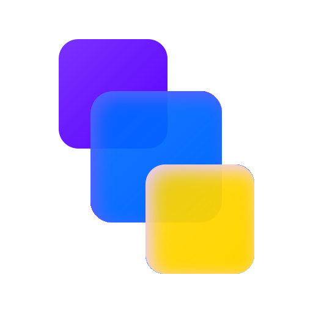
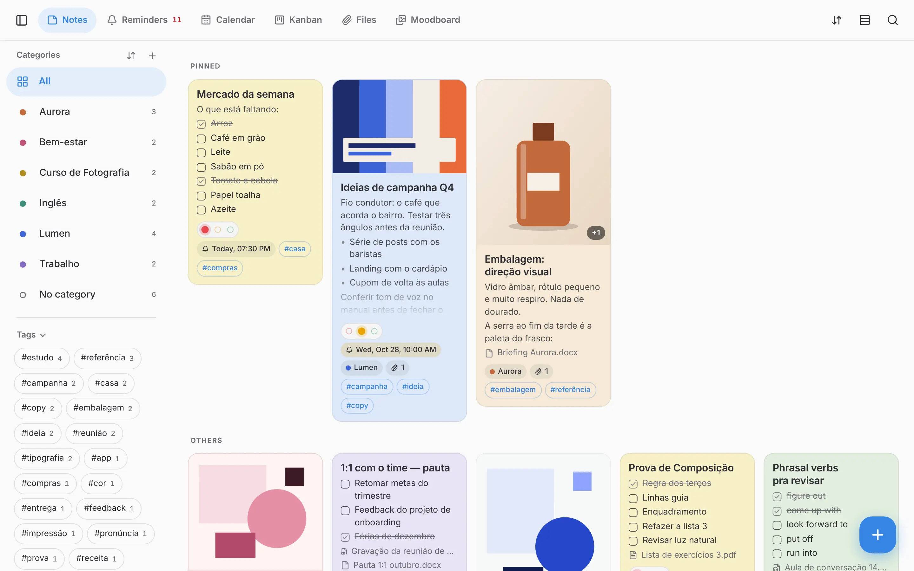
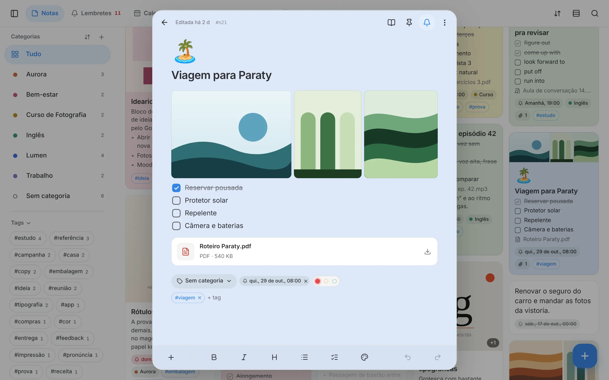
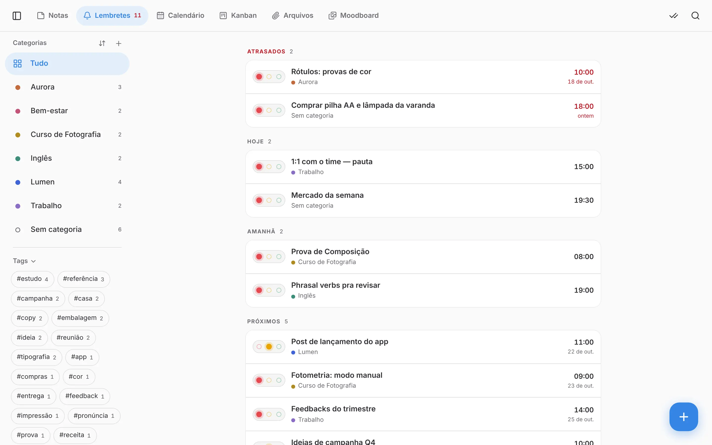
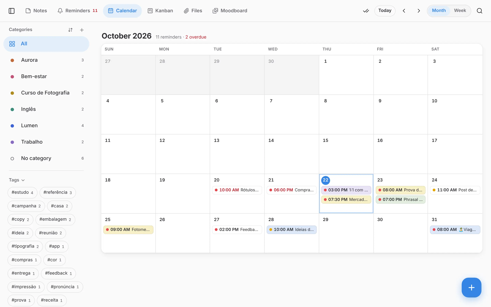
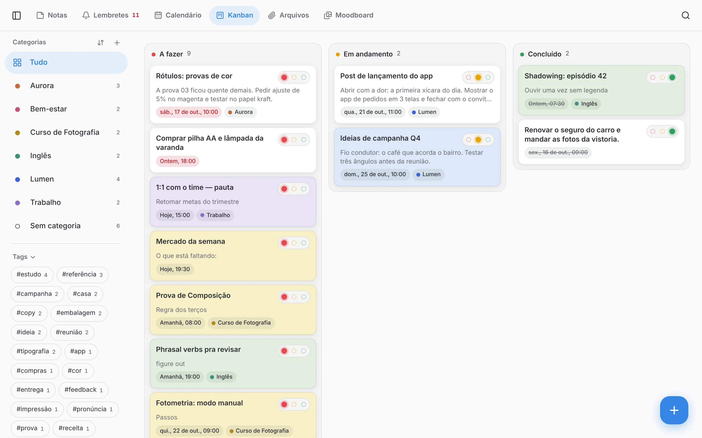
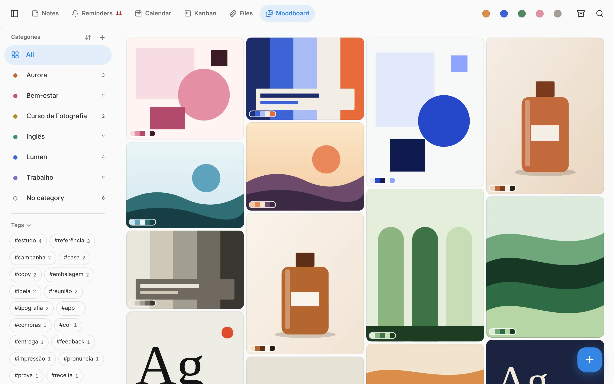
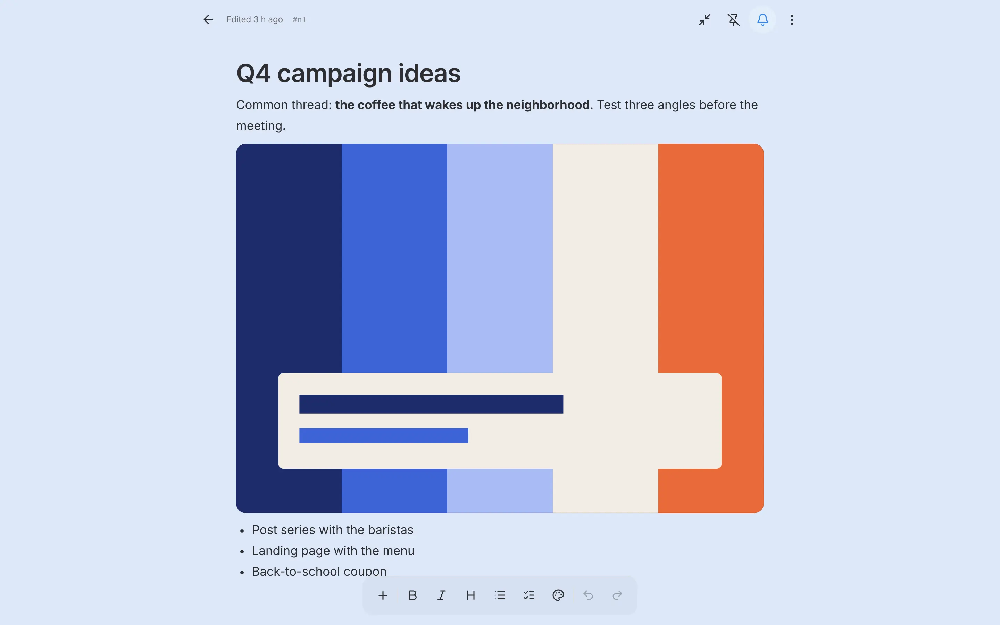
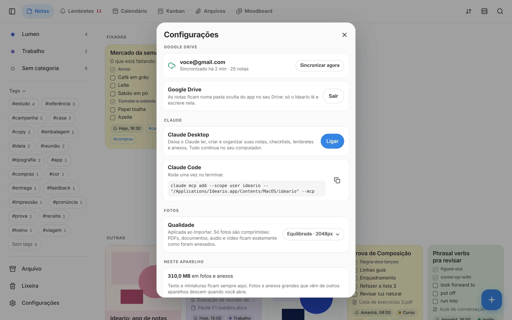
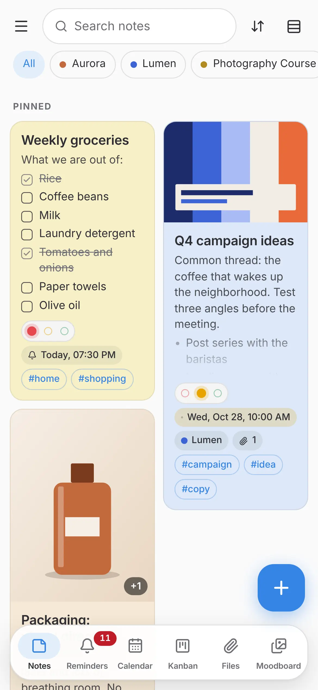

<!-- Same content as the website home page (site/index.html), with the Portuguese copy in README.pt-BR.md and site/pt/index.html. Change one, change the others: skill /sync-site. -->

<p align="center"><b>English</b> · <a href="README.pt-BR.md">Português</a></p>

<p align="center">
  
</p>

<h1 align="center">Ideario</h1>

<p align="center"><b>Organize your life in notes.</b><br>
A free, local-first notes app with reminders, a calendar and a kanban board in one place: write once and see it however
you need. It opens instantly, works offline and keeps everything on your computer. If you want, it syncs through your own
Google Drive. A private Google Keep alternative for Windows, macOS, Linux and Android.</p>

<p align="center"><a href="#whats-new-in-version-04"><b>New in version 0.4: calendar, kanban and a new icon →</b></a></p>

<p align="center">
  <b>Windows · macOS · Linux · Android</b><br>
  <a href="#download"><b>Download</b></a> ·
  <a href="https://ideario.pages.dev">ideario.pages.dev</a> ·
  <a href="https://ideario.pages.dev/privacy/">Privacy</a> ·
  <a href="README.pt-BR.md">Português</a> ·
  <a href="https://github.com/sponsors/wylho">♥ Sponsor</a>
</p>

<picture>
  <source srcset="site/img/notas-escuro.webp" media="(prefers-color-scheme: dark)">
  
</picture>

## One note, six views

Everything starts as a note. The rest are views of it, and nothing is copied: change it in one place and it changes
everywhere. Categories and tags filter any view.

| | |
|---|---|
| **Notes** | Colorful cards, pinned to the top, in whatever order you drag them. |
| **Reminders** | What’s due today, tomorrow and later, with anything overdue at the top. |
| **Calendar** | Every reminder on its day, by month or by week. |
| **Kanban** | Every note with a status, in three columns: to do, in progress and done. |
| **Files** | PDFs, audio, video and documents from all your notes, with a built-in PDF reader. |
| **Moodboard** | All your photos on one board, each with its own color palette. |

## What’s new in version 0.4

- **Calendar:** each reminder on its day, by month or week; drag it to change the day.
- **Kanban:** to do, in progress and done; drag cards between the columns.
- **Three-color status**: red, yellow and green, on any note (notes with a reminder get it automatically), also through Claude.
- **A new icon.**
- **Faster sync:** notes upload to Drive in parallel, and reordering only sends what changed.
- Long titles wrap, and search always stays in the same place in the toolbar.

In 0.4.4: an icon without a backplate on Linux and phone tweaks (selection and margins). In 0.4.3: a new icon and a subtler selection dot on cards. In 0.4.2: **status on any note**. With a reminder it appears on its own; without one, just pick it from the Status menu and the note joins the kanban board. In 0.4.1: the icon without the blue border on macOS.

<details>
<summary>Earlier versions</summary>

**0.3:** an editor with headings, quotes, code and tables; paste Markdown and screenshots straight into a note; a short
ID on every note so you can refer to it when talking to Claude.

**0.2:** Android (preview); categories sorted by name, by note count or by hand; a sidebar that turns into pills; the
window remembers its size; batched sync that carries the card order along.
</details>

If you already use Ideario, updates arrive on their own: the app lets you know when it opens. Every version is on
[Releases](https://github.com/wylho/ideario/releases).

## Everything in one note

Text, checklists, side-by-side photos, PDFs, audio and video live together in the same note, each one a block you can
drag wherever you want.

- Checklists with nested sub-items; checking an item checks everything inside it
- Record audio or take a photo without leaving the note
- Headings, quotes and tables; paste Markdown and it turns into formatting
- Paste a screenshot straight into the note
- Paste a link and it becomes a card with a title and image
- A big cover emoji to spot the note from afar



## Reminders that actually remind you

System notifications right on time, with Snooze and Done. Reminders that repeat every day, week, month or year. If your
computer was off, Ideario tells you what you missed as soon as it opens. Every reminder has a three-color status: red
(to do), yellow (in progress) and green (done).



## Calendar

The same reminders, each on its day, by month or by week. Drag one to another day and the date changes (the time
stays); tap a day’s + to create a reminder on it. Repeating reminders already show their next occurrences.



## Kanban

To do, in progress and done, in three columns. Drag a card from one column to another or tap its color selector.
Claude can do all of this too.



## A moodboard of your photos

Every image from every note on a single board, each with its color palette. Filter by tone and find that reference
without remembering which note it was in.



## When a note grows, it becomes a document

One click and the note opens full-page, with a comfortable reading column. Export it to Markdown, HTML or PDF, with its
photos and attachments.



## Works with Claude

Ideario has a built-in MCP server for Claude. Connect it to Claude Desktop or Claude Code with one click and ask: “make
a shopping list”, “check off the milk”, “what did I write about the trip?”. Claude talks to Ideario right on your
computer, with no server of ours in between, and PIN-protected categories stay out of reach. Every note has a short ID
(#a1b2c3d4): copy it and say “in note #a1b2c3d4, build a table of the expenses”. Guide: [`docs/MCP.md`](docs/MCP.md).



## Fits any window size

In a large window, a sidebar with categories and tags; close it and categories become pills above your notes. In a
narrow window, the layout adapts, with the views in a bar at the bottom. Light, dark or system theme, with the accent
colors of your Windows, macOS or Linux desktop.

<p align="center"></p>

## And more

| | |
|---|---|
| **Many at once** | Select notes with the mouse, Ctrl or Shift and change the color or category, or archive them all together, with Undo. |
| **Right-click everything** | Cards, reminders, files and categories each have their own menu, on right-click or long-press. |
| **Sync with Google Drive** | Through a hidden app folder in your own Google Drive, across computers and your phone, down to the card order. No server in between, no new account. |
| **Private categories with a PIN** | Hide a whole category from lists and search, and require a PIN to open it. Sort by name, by note count or by dragging. |
| **Coming from Google Keep?** | Drop in your Google Takeout file and your notes come in with photos, colors, labels and dates. |
| **Local backup** | One file with everything, whenever you want or every week. Restoring merges with what’s already there. |
| **Fast search** | Accent-insensitive, matches parts of words, across thousands of notes, the instant you type. |
| **Lightweight photos** | Photos are resized and stripped of location data by default. Want the original? It’s one setting away. |

<a id="download"></a>

## Download

Free. Installers are on the [GitHub releases page](https://github.com/wylho/ideario/releases/latest). Once installed,
Ideario updates itself.

| | |
|---|---|
| **Windows** | Download the `-setup.exe` and install it. When a new version comes out, the app lets you know when it opens. |
| **macOS** | Download the `.dmg` (Apple Silicon and Intel). The first time, right-click the app and choose **Open**: it isn’t signed by Apple yet. |
| **Android** (preview) | Download the `_android.apk` on your phone and open it; Android asks you to allow installing apps from that source. Reminders fire even with the app closed; share from another app to create a note. To update, install the new one over it or use Obtainium. |

<a id="linux"></a>

**Linux.** Install from the repository and Ideario updates along with the rest of your system. Ubuntu, Debian and
derivatives:

```sh
curl -fsSL https://ideario.pages.dev/linux/ideario.gpg | sudo tee /usr/share/keyrings/ideario.gpg > /dev/null
echo "deb [signed-by=/usr/share/keyrings/ideario.gpg] https://ideario.pages.dev/apt stable main" | sudo tee /etc/apt/sources.list.d/ideario.list
sudo apt update && sudo apt install ideario
```

Fedora:

```sh
sudo curl -fsSL -o /etc/yum.repos.d/ideario.repo https://ideario.pages.dev/linux/ideario.repo
sudo dnf install ideario
```

Or download the `.AppImage`, which runs on any distribution and also updates itself.

**Privacy:** no ads, no tracking, no data collection. Your notes stay on your computer and, if you want, in your Google
Drive. Read the [Privacy Policy](https://ideario.pages.dev/privacy/) and the
[Terms of Service](https://ideario.pages.dev/terms/).

---

## Development

Tauri 2 (Rust) + Svelte 5. Specification (in Portuguese): [`docs/SPEC.md`](docs/SPEC.md). Design prototype:
[`prototype/`](prototype/).

**Requirements:** Node 20+ and stable Rust (`rustup`), plus
[Tauri’s system dependencies](https://v2.tauri.app/start/prerequisites/) (on Linux: `libwebkit2gtk-4.1-dev`,
`libayatana-appindicator3-dev`, `librsvg2-dev`, `libxdo-dev`, `libssl-dev`).

```sh
npm install

npm run tauri dev      # desktop app with live reload
npm run tauri build    # installers in src-tauri/target/release/bundle/

npm run dev            # just the interface in the browser (http://localhost:1420), with fictional sample data
npm run check          # types (svelte-check)
npm run test:e2e       # behavior tests in Chromium
cd src-tauri && cargo test
```

Google Drive sync: [`docs/GOOGLE_DRIVE.md`](docs/GOOGLE_DRIVE.md). Website: the [`site/`](site/) folder (Cloudflare
Pages), English at the root and Portuguese in `site/pt/`; screenshots in `site/img`, regenerated with
`npm run build && node scripts/site-shots.mjs`.

Shortcuts: <kbd>Ctrl/Cmd</kbd>+<kbd>N</kbd> new note, <kbd>Ctrl/Cmd</kbd>+<kbd>F</kbd> search, <kbd>Esc</kbd> closes the editor.
